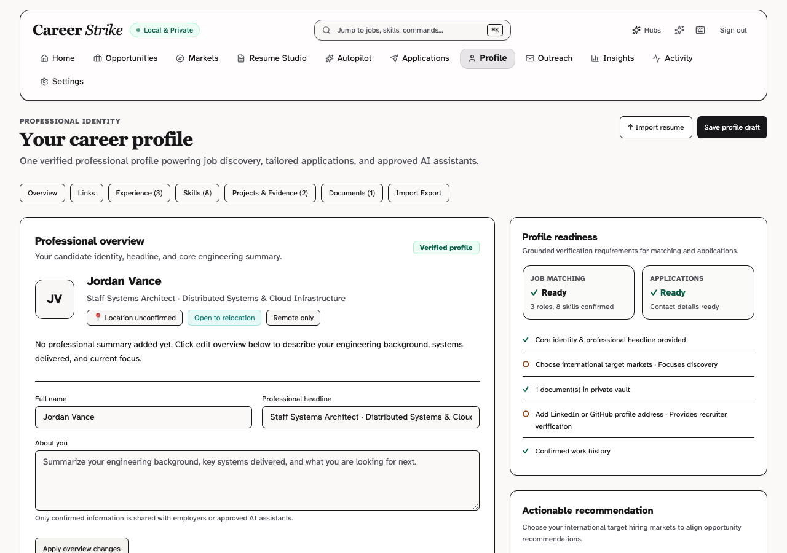
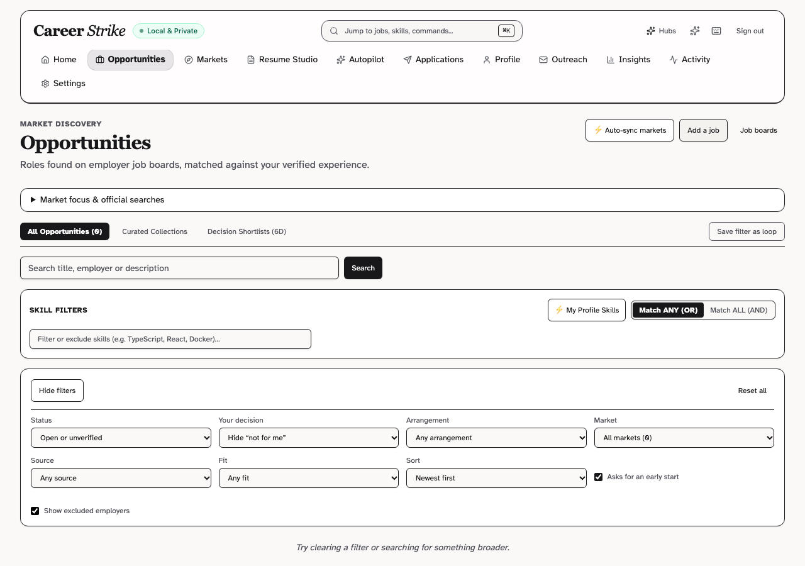
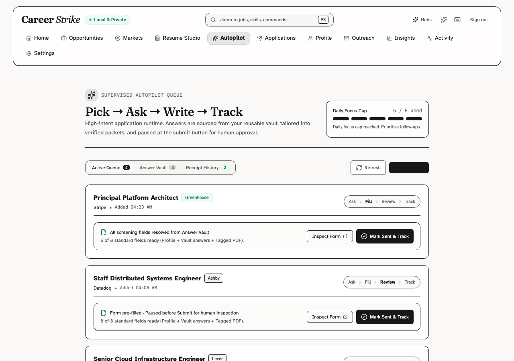
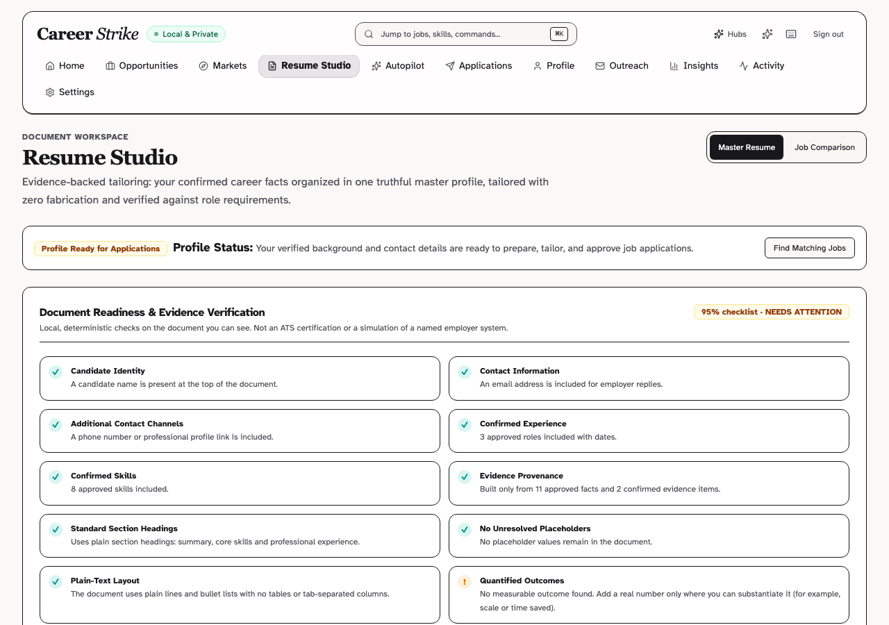
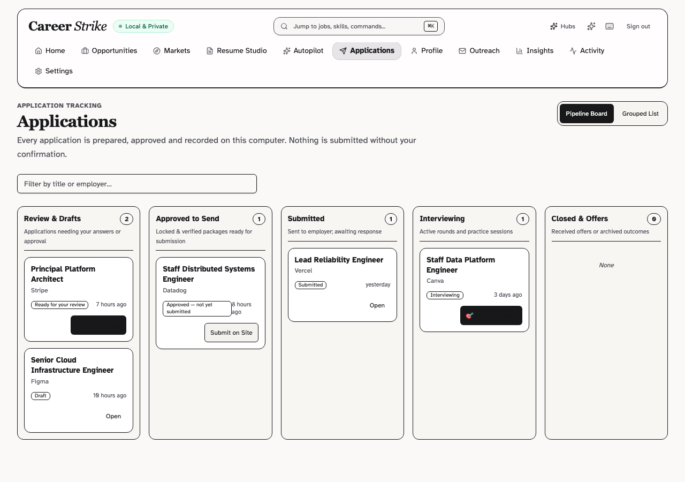
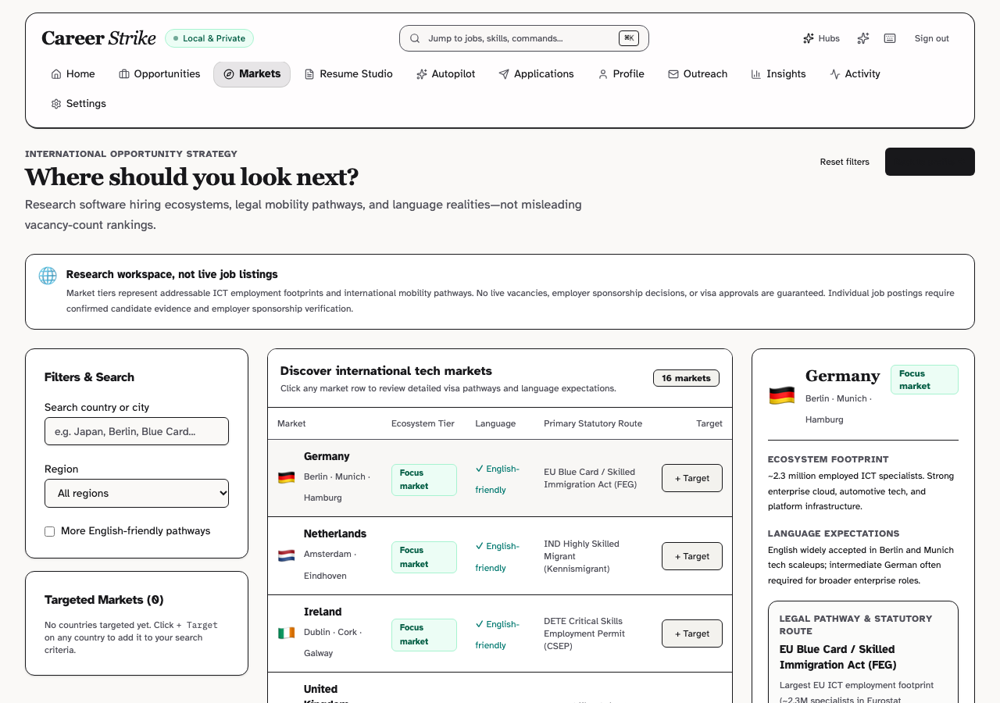
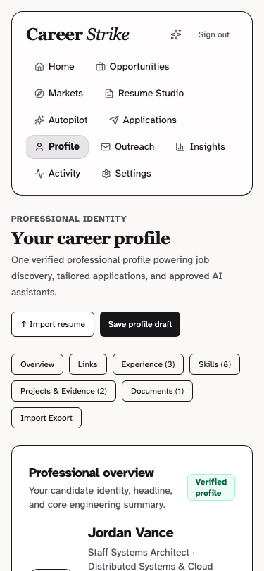

# Career Strike

### Your next career move, made simpler.

**Find opportunities. Understand your strengths. Prepare better applications. Move forward with confidence.**

[](CHANGELOG.md)
[](LICENSE)
[](docs/privacy.md)
[](docs/job-hunt-guide.md#optional-connect-an-ai-assistant)

Career Strike is a private, local-first workspace designed to guide IT professionals through every stage of their job search—from discovering verified openings to preparing evidence-backed applications and tracking interviews.

Whether you are a **Software Engineer**, **Product Manager**, **Business Analyst**, **QA & Test Engineer**, **Data Analyst**, **Cloud & DevOps Engineer**, **UI/UX Designer**, **IT Support Specialist**, **Cybersecurity Professional**, **Technical Writer**, **Customer Success / Solutions Architect**, or a **Career Changer**, Career Strike helps you take control of your career journey without surrendering your private data to third-party clouds or automated application spam.

---

## Jump To

- [Interactive Candidate Welcome](#the-interactive-candidate-welcome)
- [How Career Strike Works](#how-career-strike-works)
- [Verified Product Capabilities](#verified-product-capabilities)
- [Feature Showcase](#feature-showcase)
- [Explore Opportunities Worldwide](#explore-opportunities-worldwide)
- [LinkedIn Profile & Data Integration](#linkedin-profile--data-integration)
- [Get Started — No Coding Required](#get-started--no-coding-required)
- [Optional: Connect an AI Assistant & .mcpb](#optional-connect-an-ai-assistant)
- [Candidate Trust & Data Privacy](#candidate-trust--data-privacy)
- [Frequently Asked Questions](#frequently-asked-questions)
- [Developer Reference & Commands](#developer-reference--commands)
- [Documentation & Guides](#documentation--guides)
- [License](#license)

---


_Figure 1: The Career Strike Candidate Profile Workspace. A single, evidence-backed source of truth for your summary, skills, experience, and mobility preferences._

---

## The Interactive Candidate Welcome

Starting a job search can feel overwhelming. Career Strike includes a dedicated 4-step onboarding experience to help you clarify your path before opening a single vacancy:

| Step       | Question                           | What You Choose                                                                                                                                    | Why It Matters                                                                              |
| :--------- | :--------------------------------- | :------------------------------------------------------------------------------------------------------------------------------------------------- | :------------------------------------------------------------------------------------------ |
| **Step 1** | **What do you do?**                | Select your IT discipline (e.g. Business Analyst, Software Engineer, Product Manager, QA) or enter your exact headline.                            | Tailors the keywords and skill requirements used during job discovery and match evaluation. |
| **Step 2** | **Where would you like to work?**  | Choose your working arrangement (Remote, Local, or Relocation) and select target countries (e.g. Germany, Netherlands, Ireland, Singapore, Japan). | Eliminates roles with incompatible residency, sponsorship, or location constraints.         |
| **Step 3** | **What would you like help with?** | Identify your immediate priority: finding verified openings, reviewing resume claims, exploring visa pathways, or preparing tailored applications. | Directs your initial focus so you make steady progress without unnecessary distraction.     |
| **Step 4** | **Get your personalized plan**     | Generate a customized job-search strategy plan with target roles, curated employer feeds, statutory visa realities, and next steps.                | Provides a clear starting plan and a ready-to-use prompt for your chosen AI assistant.      |

> [!TIP]
> **Try the Interactive Welcome in Your Browser**: You can explore the interactive 4-step welcome experience right now with sample data. Open [`docs/candidate-welcome.html`](docs/candidate-welcome.html) in any browser. It runs 100% locally with zero installation.

---

## How Career Strike Works

Career Strike organizes your job hunt into a deliberate, candidate-controlled journey:

```text
Create Your Profile ──> Discover Jobs ──> Understand Match ──> Prepare Application ──> Apply ──> Track Progress
```

Every stage is built around candidate agency and factual transparency:

| Stage           | What You Do                                                               | What Career Strike Does                                                                  | Required Information                         | AI Involvement              | Candidate Approval                                 |
| :-------------- | :------------------------------------------------------------------------ | :--------------------------------------------------------------------------------------- | :------------------------------------------- | :-------------------------- | :------------------------------------------------- |
| **1. Profile**  | Add your skills, work history, target roles, and location preferences.    | Organizes your background into an evidence-backed career record. Highlights gaps.        | Resume (optional), core skills, past titles. | None by default.            | You approve every saved fact.                      |
| **2. Discover** | Add public employer career pages (Greenhouse, Lever, Ashby) to monitor.   | Automatically retrieves active postings directly from the employer's official feed.      | Board URL or employer name.                  | None.                       | You decide which boards to follow.                 |
| **3. Match**    | Review postings and filter by location, remote policy, and fit tier.      | Compares job requirements against your confirmed profile facts and quotes employer text. | Stored profile facts + posting text.         | None (deterministic rules). | You decide to Shortlist or Exclude.                |
| **4. Prepare**  | Open a shortlisted role and generate tailored resume/cover letter drafts. | Aligns your actual accomplishments to the role's requirements without inventing claims.  | Target job + your approved experience.       | Optional local drafting.    | You review and cryptographically sign the package. |
| **5. Apply**    | Visit the employer's official portal and submit the application yourself. | Keeps your signed package ready for reference; never spams employers for you.            | Employer application link.                   | None.                       | You perform and confirm the submission.            |
| **6. Track**    | Record interview dates, export calendar invites (`.ics`), and follow up.  | Maintains your kanban pipeline, schedules reminders, and generates outreach drafts.      | Status updates, interview notes.             | Optional draft generation.  | You approve all communications.                    |

---

## Verified Product Capabilities

We believe in complete product truth. The table below outlines the exact implementation status of all Career Strike capabilities based on the repository test suite and acceptance registry:

| Capability                               |   Status    | Implementation Details & Evidence                                                                                                                                                                |
| :--------------------------------------- | :---------: | :----------------------------------------------------------------------------------------------------------------------------------------------------------------------------------------------- |
| **Local-First Privacy**                  | `AVAILABLE` | Service and SQLite database bind strictly to `127.0.0.1`. No telemetry, analytics, or cloud accounts ([`docs/privacy.md`](docs/privacy.md)).                                                     |
| **Candidate Profile Workspace**          | `AVAILABLE` | Human-crafted career profile view with inline editing, headline, summary, links, and evidence tags ([`Profile`](src/web/pages/Profile/index.tsx)).                                                 |
| **Resume Document Storage**              | `AVAILABLE` | Upload and local storage for PDF and DOCX files in the user's private data folder ([`docs/job-hunt-guide.md`](docs/job-hunt-guide.md)).                                                          |
| **LinkedIn Archive (Zip/CSV) Import**    | `AVAILABLE` | Client-side parsing of candidate-provided LinkedIn export files (`Positions.csv`, `Skills.csv`, `Education.csv`) with conflict review.                                                           |
| **Direct Employer Job Discovery**        | `AVAILABLE` | Automated polling of official public Greenhouse, Lever, and Ashby career feeds ([`docs/install.md`](docs/install.md)).                                                                           |
| **Autopilot Queue & Answer Vault**       | `AVAILABLE` | Clera-inspired Pick → Ask → Write → Track flow, reusable screening answer vault (`answer_vault`), daily focus cap, supervised pause-before-submit confirmation, honest clipboard fallback for blocked portals, and tactile receipts ([`src/web/pages/Autopilot/`](src/web/pages/Autopilot/index.tsx)). |
| **Company Intelligence 360**             | `AVAILABLE` | Canonical company profile model: stage, headcount trend, funding history, tech stack, and dated observation provenance ([`src/markets/company-intelligence.ts`](src/markets/company-intelligence.ts)). |
| **Startup Momentum Radar**               | `AVAILABLE` | Real-time momentum classification (`SURGING`, `STEADY`, `STAGNANT`, `COOLING`) and timeline tracking without speculative vacancies.                                                               |
| **Decision-Ready Opportunity Shortlists**| `AVAILABLE` | 6-dimension evaluation (Eligibility, Relevance, Preferences, Confidence, Context, Effort) and next-best actions without collapsing eligibility failures ([`src/matching/shortlist.ts`](src/matching/shortlist.ts)). |
| **Curated Career Collections**           | `AVAILABLE` | 8 rule-based market collections (Emerging AI, Fintech, High Growth, Remote First, etc.) plus candidate custom collection builder ([`src/career/collections.ts`](src/career/collections.ts)).    |
| **Compensation & Offer Intelligence**    | `AVAILABLE` | Source-aware benchmarks with P25/P50/P75 ranges ($N \ge 5$ threshold), offer evaluation, and strict purchasing-power caveats ([`src/career/compensation.ts`](src/career/compensation.ts)).       |
| **Offer Intelligence Lab**               | `AVAILABLE` | Competing offer comparison against P25/P50/P75 market curves, total comp breakdown, and custom counter-offer scenario modeling ([`src/web/pages/Offers/`](src/web/pages/Offers/index.tsx)).       |
| **Warm-Path Referral CRM**               | `AVAILABLE` | Professional contact directory with interaction timelines, referral opportunity mapping, and warm outreach templates ([`src/web/pages/Contacts/`](src/web/pages/Contacts/index.tsx)).         |
| **STAR Story Vault & Voice Rehearsal**   | `AVAILABLE` | Structured behavioral STAR story library, competency taxonomy, and interactive real-time audio voice simulation rehearsal ([`src/web/pages/StarVault/`](src/web/pages/StarVault/index.tsx)).  |
| **Hired Mode Onboarding Accelerator**    | `AVAILABLE` | 30-60-90 day onboarding roadmap generator, promotion scope tiers, and continuous brag doc recording ([`src/web/pages/HiredMode/`](src/web/pages/HiredMode/index.tsx)).                         |
| **Chrome Native Messaging Clipper**      | `AVAILABLE` | 1-click job clipping browser extension for LinkedIn, Workday, and Naukri with zero external cloud credentials ([`plugins/chrome-clipper/`](plugins/chrome-clipper/)).                           |
| **Sovereign `.mcpb` Desktop Bundle**     | `AVAILABLE` | Zero-configuration double-clickable desktop bundle for Claude Desktop with strict permission-tiered context server (`npm run pack:mcpb`).                                                          |
| **Read-Only IMAP Recruiter Polling**     | `AVAILABLE` | Local-only, read-only IMAP synchronization for interview invites and recruiter updates with TLS verification.                                                                                    |
| **Calm Editorial Design System**         | `AVAILABLE` | High-contrast semantic palette (90% neutral surfaces, 8% structural borders/secondary ink, 2% accent) with WCAG AAA status signals and automated Playwright contrast gate ([`src/web/index.css`](src/web/index.css)). |
| **Career Market Pulse**                  | `AVAILABLE` | Aggregated local metrics on remote work distribution, skills in demand, and 14-day hiring velocity ([`src/career/market-pulse.ts`](src/career/market-pulse.ts)).                                 |
| **Interview Knowledge Studio**           | `AVAILABLE` | Stage format playbooks, 4-step company research framework, principled negotiation tactics, and attributed resources ([`src/interview/knowledge-studio.ts`](src/interview/knowledge-studio.ts)). |
| **Manual Opportunity Recording**         | `AVAILABLE` | Add unlisted roles from any source; explicitly tagged `UNVERIFIED` until verified.                                                                                                               |
| **Evidence-Backed Match Evaluation**     | `AVAILABLE` | Deterministic fit scoring (`EXCELLENT`, `STRONG`, `MODERATE`, `BASIC`) derived from verified facts and quoted employer text.                                                                     |
| **Application Pipeline & Kanban**        | `AVAILABLE` | Full stage tracking: Saved, Shortlisted, Prepared, Approved, Submitted, Follow-up, Interviewing, Offer, Closed.                                                                                  |
| **Tailored Document Studio**             | `AVAILABLE` | Evidence-backed resume and cover-letter draft generation with side-by-side claim comparison ([`docs/document-personalization.md`](docs/document-personalization.md)).                            |
| **Cryptographic Application Approval**   | `AVAILABLE` | HMAC-SHA256 signature locks the exact approved application version; any edit invalidates approval.                                                                                               |
| **Automated Real-Employer Submissions**  |  `PLANNED`  | **Intentionally disabled.** Candidates submit on official employer portals. Automated submission is tested _only_ against the local practice ATS ([`docs/limitations.md`](docs/limitations.md)). |
| **Interview Prep & STAR Coaching**       | `AVAILABLE` | STAR behavioral prompt generator based on role requirements and confirmed candidate accomplishments.                                                                                             |
| **Interview iCalendar (.ics) Export**    | `AVAILABLE` | Generates RFC-5545 compliant `.ics` calendar files for scheduled interview stages.                                                                                                               |
| **Outreach Draft Studio**                | `AVAILABLE` | Contextual follow-up email drafts for status checks, post-interview thank-you notes, and offer next steps.                                                                                       |
| **Global Market Explorer Matrix**        | `AVAILABLE` | 16-country research matrix with statutory visa pathways, language expectations, and official policy citations.                                                                                   |
| **Model Context Protocol (MCP) Server**  | `AVAILABLE` | Stdio MCP server with 20 scoped tools (companies, hiring signals, compensation, market pulse, watchlist, jobs, fit, disclosures).                                                                 |
| **Single-Use Personal Info Disclosures** | `AVAILABLE` | AI assistants request specific fields with a stated purpose; you preview and approve exact values in the dashboard.                                                                              |
| **Data Export, Backup & Rollback**       | `AVAILABLE` | CLI commands for transactional export, backup, restore, and pre-upgrade rollback.                                                                                                                |
| **Personal Career Mission Engine**      | `AVAILABLE` | Dual-track career mission model (Track A immediate vs Track B growth) with salary floor, mobility, and effort allocation ([`src/career/mission.ts`](src/career/mission.ts)). |
| **Assistant Desk & Autonomous Planner**  | `AVAILABLE` | Daily executive briefing on `/`, multi-phase execution planner, and transparent assistant activity ledger ([`src/career/planner.ts`](src/career/planner.ts)). |
| **Proactive Opportunity Hunter**         | `AVAILABLE` | Track-aware opportunity hunting matching live postings to mission criteria without speculative vacancies ([`src/career/proactive-hunter.ts`](src/career/proactive-hunter.ts)). |
| **Application Concierge & Rehearsal**    | `AVAILABLE` | 7-point readiness checklist, custom screening gap review, and candidate-controlled submission guarantee ([`src/applications/rehearsal.ts`](src/applications/rehearsal.ts)). |
| **Multi-Offer Decision Adviser**         | `AVAILABLE` | Evaluates competing offers against P25/P50/P75 market benchmarks and generates role-specific negotiation talking points ([`src/career/offer-adviser.ts`](src/career/offer-adviser.ts)). |
| **Continuous Strategy Evaluation Harness**| `AVAILABLE`| 11-scenario, 29-check invariant evaluation suite verifying track isolation, candidate control, and data provenance ([`src/learning/evaluation.ts`](src/learning/evaluation.ts)). |
| **Permanent Data Erasure**               | `AVAILABLE` | Single-command complete wipe of local databases, documents, and OS keychain items.                                                                                                               |

---

## Feature Showcase

### 0. The Personal Career Chief of Staff & Assistant Desk

Career Strike acts as your proactive, trustworthy career chief of staff, turning ambiguous career ambitions into structured execution while keeping you firmly in control:

- **Durable Career Missions**: Separate confirmed profile facts from exploratory preferences with dual tracks: **Track A** (realistic, high-confidence near-term employment) and **Track B** (ambitious, high-leverage growth targets).
- **Assistant Desk & Daily Mission Briefing**: Get an executive summary on your dashboard featuring today's top recommended actions, proactive opportunity highlights, and pending strategy suggestions.
- **Autonomous Career Planner & Activity Ledger**: Automatically maps out multi-phase execution plans across Discovery, Preparation, Outreach, and Evaluation, tracked in an auditable activity ledger.
- **Application Concierge & Pre-Flight Rehearsal**: Ensure every submission packet is candidate-verified with a 7-point pre-flight checklist, custom screening answer reviews, contradiction detection, and zero autonomous mass-submission guarantees.
- **Multi-Offer Decision Adviser & Outreach**: Objectively compare competing job offers against local market compensation curves (P25/P50/P75) and leverage structured outreach templates for high-impact follow-ups.

---

### 1. Candidate Career Profile & Evidence Graph

The default profile view is designed as a calm, professional career workspace rather than an intimidating registration form:

- **Identity & Summary**: Maintain your professional headline, narrative summary, and primary competencies.
- **Verified Skills & Evidence**: Distinguish skills confirmed by your experience from unconfirmed suggestions, tracked with full audit revision history and actor provenance (`last_confirmed_at`, `last_confirmed_by`).
- **Career Preferences**: Set role preferences, working arrangements (Remote, Hybrid, Onsite), and target countries.
- **Conflict Review**: Transparently review conflicting claims imported from external documents or archives with explicit conflict resolution tools.

---

### 2. Smart Job Discovery & Curated Collections Hub

Career Strike bypasses noisy job aggregators and stale scraping by connecting directly to official applicant tracking systems (Greenhouse, Lever, Ashby):


_Figure 2: Job discovery displaying direct employer postings, salary disclosure transparency, and evidence-backed fit tiers._

- **Direct Employer Feeds**: Follow company career boards powered by Greenhouse, Lever, or Ashby with zero scraping and zero credential requirements.
- **Freshness Guarantees**: Postings verified within 72 hours are marked `OPEN`; inactive postings transition to `STALE` or `CLOSED`.
- **Curated Collections Hub**: Discover opportunities through 8 dynamic, rule-based collections (Emerging AI, Fintech, High Growth, Remote First, Active Product Roles, QA/IT Ops, International Employers, Early Career/Transition) computed live against local data.
- **Custom Candidate Collections**: Define and save personal collection rules based on seniority, domain, work arrangement, and tech stack tags.

---

### 3. Autopilot Queue & Reusable Answer Vault

Eliminate repetitive ATS application grinding with a Clera-inspired **Pick → Ask → Write → Track** execution pipeline that keeps you firmly in control:


_Figure 3: The Career Strike Autopilot Queue. Multi-job batching, inline Quick Question micro-cards with Answer Vault reuse, honest Workday clipboard fallback, and tactile receipt cards._

- **Batch Discovery Picker**: Select multiple verified openings directly on `/opportunities` with clear ATS provider indicators (`on Greenhouse`, `on Lever`, `on Ashby`). The floating action bar enforces your Daily Focus Cap (default 5/day) and flags duplicate company warnings to protect quality over volume.
- **Reusable Answer Vault (`answer_vault`)**: Standard screening answers (work authorization, notice period, relocation, compensation expectations) are stored once locally. When a form asks a new question, a Quick Question micro-card pops up inline—answer it once with "Save as default" and never type it again.
- **Supervised Pause-Before-Submit**: Autofill populates the ATS fields using frozen resume snapshots and approved facts, but strictly halts at the final submission button. You inspect every field and click submit with your own hands.
- **Honest Blocked-Portal Fallback**: When an enterprise portal (such as Workday) resists reliable supervised fill, Career Strike never guesses or fails silently. It presents a calm fallback card with 1-click clipboard copy buttons for your contact info and tailored screening answers.
- **Tactile Application Receipts**: Completed submissions produce verifiable receipt cards (`Sent · 2:14 pm · 14 fields filled · Verified PDF attached · Tracked as Applied`) linked directly to the immutable PDF snapshot.

---

### 4. Decision-Ready Opportunity Shortlists (6D Engine)

Rather than collapsing complex career evaluations into a misleading single percentage, Career Strike evaluates opportunities across six orthogonal, non-negotiable dimensions:

- **Hard Eligibility**: Validates statutory right to work, residency, and employer sponsorship policy. Critical blockers prevent false recommendations.
- **Professional Relevance**: Evaluates overlap between quoted employer requirements and candidate-verified skills and accomplishments.
- **Candidate Preferences**: Checks alignment with target roles, compensation requirements, preferred work arrangements, and company stages.
- **Source Confidence**: Differentiates direct ATS feeds with fresh observation timestamps from manual or third-party entries.
- **Company Context**: Factors in organization stage, headcount trajectory, financial runway, and tech stack suitability.
- **Application Effort**: Assesses required preparation effort (screening questions, portfolios, technical assessments, work authorization attestations).
- **Actionable Next Steps**: Automatically synthesizes a concrete `nextBestAction` (`PREPARE_APPLICATION`, `VERIFY_ELIGIBILITY`, `RESEARCH_COMPANY`, `PASS`).

---

### 5. Company Intelligence 360 & Startup Momentum Radar

Inspect companies with full context and dated observation provenance before investing application effort:

- **Canonical Company Model**: 360-degree overview covering company stage (Seed through Public), industry domain, headquarters/hiring locations, headcount history, funding rounds, and verified tech stack.
- **Startup Momentum Radar**: Classifies momentum trends (`SURGING`, `STEADY`, `STAGNANT`, `COOLING`) based strictly on observed local hiring activity and dated corporate events—without fabricated trajectory scores or speculative vacancy estimates.
- **Company Event Timeline**: Track corporate milestones, funding announcements, and newly confirmed open roles chronologically.
- **Candidate Watchlist**: Add target employers to a monitored watchlist with priority tiers and custom notification thresholds.

---

### 6. Compensation & Offer Intelligence Lab

Make informed compensation decisions backed by evidence, statistical rigour, and multi-offer comparison:

- **Multi-Source Benchmark Awareness**: Explicitly distinguishes Employer-Disclosed ranges, External Compensation Benchmarks, Candidate-Reported data, and Model Estimates—never silently blended.
- **Statistically Grounded Percentiles**: Displays P25, P50 (median), and P75 compensation curves only when backed by a verified sample size ($N \ge 5$). When data is insufficient, percentiles are omitted rather than guessed.
- **Total Compensation Breakdown**: Separates base salary, variable bonus, signing bonus, and documented equity grants.
- **Offer Intelligence Lab (`/offers`)**: Compare competing job offers side-by-side against market percentiles, model equity appreciation and vesting schedules, and generate role-specific negotiation talking points.
- **Purchasing-Power Caveats**: Explicitly notes that nominal FX currency conversion does not equate to purchasing power or cost-of-living parity.

---

### 7. Career Market Pulse & Interview Knowledge Studio

- **Career Market Pulse**: Live local telemetry displaying remote vs hybrid vs onsite distribution, top in-demand competencies, salary ranges, and 14-day hiring velocity across active markets.
- **Interview Knowledge Studio**:
  - *Stage Format Playbooks*: Concrete preparation blueprints for Recruiter Screening, System Design & Architecture, Behavioral STAR rounds, and Executive Deep-Dives.
  - *4-Step Company Research*: Structured framework covering business model analysis, technical architecture discovery, team dynamics, and competitive landscape.
  - *Principled Negotiation*: Tactical guidance for total compensation negotiation, counter-offer evaluation, and equity vesting review.
  - *Attributed Guidance*: Curated, dated citations from verified industry practitioners.

---

### 8. STAR Story Vault & Voice Rehearsal Studio

Master behavioral interview rounds with a dedicated STAR repository and interactive voice simulation:

- **Structured STAR Framework**: Capture high-impact career stories structured into **Situation**, **Task**, **Action**, and **Result** with quantitative impact metrics.
- **Competency Taxonomy**: Tag stories with core competencies (Leadership, Conflict Resolution, System Architecture, Ambiguity, Delivering Results) for instant retrieval during interview prep.
- **Voice Rehearsal Simulator**: Practice articulating your stories aloud using browser Web Audio / speech synthesis, receiving instant pacing and clarity feedback before speaking to real hiring managers.
- **Role Alignment**: Directly links verified STAR stories to job requirements in your active pipeline.

---

### 9. Resume & Cover Letter Studio

Create tailored application documents without hallucinated qualifications or generic AI filler:


_Figure 4: Tailored document drafting with 3-pane Master Vault outliner, XYZ bullet editor, side-by-side fact verification, and candidate approval locking._

- **Evidence-Backed Drafts**: Tailored resumes and cover letters draw strictly from confirmed profile facts.
- **3-Pane Studio Workspace**: Master Vault Outliner, XYZ Bullet Editor with real-time scoring, and live document preview with lens switching (Print, Screen, ATS Audit).
- **Side-by-Side Review**: Compare draft statements against employer requirements and your master profile before accepting changes.
- **Candidate Approval Lock**: Approving an application cryptographically signs the package with HMAC-SHA256. Editing any field clears the approval so you never accidentally submit outdated content.
- **Offline PDF & DOCX Export**: Generates clean, standalone PDF-1.4 and OpenXML DOCX packages with local extractability testing.

---

### 10. Application Pipeline & Warm-Path Referral CRM

Keep all your active opportunities organized in one unified workflow with relationship context:


_Figure 5: Candidate pipeline tracking applications from draft through submission, interview scheduling, and offer stages._

- **Structured Stages**: Track roles across Draft, Shortlisted, Prepared, Approved, Submitted, Follow-up, Interviewing, Offer, and Closed.
- **Warm-Path Referral CRM (`/contacts`)**: Maintain a private directory of professional contacts, past colleagues, and recruiters. Career Strike cross-references job applications with your contacts to highlight warm referral paths before you submit cold applications.
- **STAR Interview Coaching**: Generate behavioral interview preparation prompts based on the employer's quoted requirements and your confirmed projects.
- **iCalendar (.ics) Sync**: Export scheduled interview dates directly into Apple Calendar, Google Calendar, or Outlook.
- **Outreach Studio**: Persisted contact directory and contextual follow-up email drafts for status checks, post-interview thank-you notes, and offer discussions.

---

### 11. Hired Mode & Onboarding Acceleration

Career Strike supports you beyond receiving an offer into your first critical 90 days:

- **30-60-90 Day Roadmap Generator**: Automatically builds an actionable onboarding plan tailored to your new role, level, and company domain.
- **Continuous Brag Doc Recording**: Log early wins, resolved incidents, architecture reviews, and stakeholder praise as they happen.
- **Promotion Scope Tiers**: Map your achievements against individual, team, and organizational impact tiers to prepare for your first performance review from day one.

---

### 12. Global Career Explorer

Research international technology markets with grounded, evidence-backed clarity:


_Figure 6: International market matrix displaying statutory immigration pathways, language expectations, and tech ecosystems._

- **No Artificial Rankings**: Countries are categorized by ecosystem depth, language fit, and immigration feasibility—not arbitrary vacancy counts.
- **Statutory Pathway Realities**: Clear references to real visa frameworks (e.g. EU Blue Card in Germany, Critical Skills Employment Permit in Ireland, COMPASS points in Singapore).
- **Language Expectations**: Highlights where English is standard in tech teams versus where local language fluency (e.g. Japanese JLPT N2/N1) is expected.
- **Target Market Shortlisting**: Select target countries to automatically prioritize relevant openings in your discovery feed.

---

### 13. Responsive Mobile Experience

Career Strike is designed to adapt gracefully to mobile screens for reviewing opportunities and updating application status on the go:

<p align="center">
  
  <br />
  <em>Figure 7: Candidate profile and navigation optimized for 375px mobile viewports without horizontal scrolling.</em>
</p>

---

### 14. Chrome Native Messaging Clipper & Sovereign `.mcpb` Bundle

Capture jobs from anywhere and plug into your preferred AI assistants securely:

- **Chrome Clipper Extension (`plugins/chrome-clipper/`)**: A native browser extension that clips job postings from LinkedIn, Workday, Greenhouse, Lever, and Naukri with 1 click. Uses Chrome Native Messaging to communicate directly with your local Career Strike service—zero cloud proxies, zero auth tokens shared with browser extensions.
- **Sovereign `.mcpb` Desktop Bundle**: Package Career Strike as a single double-clickable `.mcpb` bundle (`npm run pack:mcpb`) for Claude Desktop and Claude Code, giving frontier agents full read/write access to your career context under strict classification boundaries.
- **Read-Only IMAP Recruiter Polling**: Securely connects to your personal mailbox using local-only read-only IMAP with TLS verification to extract interview scheduling emails and recruiter status updates into your timeline.

---

## Explore Opportunities Worldwide

Career Strike provides dedicated research and discovery guides for major global technology ecosystems:

### Europe

- [**Germany**](docs/germany-job-discovery.md) (`DE`): Largest EU ICT employment footprint (~2.3M specialists). Strong cloud, enterprise software, and automotive tech. Statutory pathway: EU Blue Card / Skilled Immigration Act (FEG).
- [**United Kingdom**](docs/uk-job-discovery.md) (`GB`): Major English-speaking market with deep venture capital, fintech, and AI ecosystems. Statutory pathway: Skilled Worker Visa (Licensed Sponsor).
- **Netherlands** (`NL`): High English fluency; major semiconductor, fintech, and multinational European engineering hubs. Statutory pathway: IND Highly Skilled Migrant (Kennismigrant).
- **Ireland** (`IE`): European headquarters for global software and cloud infrastructure leaders. Statutory pathway: DETE Critical Skills Employment Permit (CSEP).
- **Nordics & Central Europe**: Coverage and research for Finland (`FI`), Sweden (`SE`), Poland (`PL`), Czechia (`CZ`), Estonia (`EE`), and Portugal (`PT`).

### Asia & Middle East

- [**India**](docs/india-job-discovery.md) (`IN`): Global Innovation Centers (GCCs), enterprise tech platforms, and high-growth engineering scaleups across Bengaluru, Hyderabad, and Pune.
- [**Singapore**](docs/singapore-job-discovery.md) (`SG`): Premier Southeast Asian regional headquarters hub for fintech and global enterprise tech. Statutory pathway: MOM Employment Pass (evaluated via COMPASS criteria).
- [**Japan**](docs/japan-job-discovery.md) (`JP`): Major robotics, e-commerce, and gaming sectors. English roles concentrate in international scaleups; Japanese fluency significantly widens opportunities. Statutory pathway: Engineer / Specialist in Humanities.
- [**Southeast Asia**](docs/southeast-asia-job-discovery.md): Regional tech discovery across Malaysia (`MY`), Indonesia (`ID`), the Philippines (`PH`), Thailand (`TH`), and Vietnam (`VN`).
- [**United Arab Emirates**](docs/uae-job-discovery.md) (`AE`): Rapidly expanding tech hub across Dubai and Abu Dhabi for cloud, AI, and fintech. Statutory pathway: MoHRE Skilled Worker / Green Visa.

### North America & Oceania

- [**Canada**](docs/canada-job-discovery.md) (`CA`): AI research clusters and North American tech engineering centers.
- [**Australia**](docs/australia-job-discovery.md) (`AU`): Enterprise SaaS, tech unicorns, and regional technology hubs across Sydney and Melbourne.

---

## LinkedIn Profile & Data Integration

Career Strike treats LinkedIn as a complementary source of candidate-provided facts, not an invasive data pipeline:

1. **Adding Your LinkedIn URL**: You can record your public LinkedIn profile link (`https://linkedin.com/in/your-profile`) in your profile. Career Strike validates the URL syntax for formatting; it **never** claims this verifies profile ownership.
2. **Importing Your Profile Archive**: You can download your official data archive from LinkedIn (Settings → Data Privacy → Get a copy of your data) and import `Positions.csv`, `Skills.csv`, and `Education.csv` directly into Career Strike.
3. **Candidate Review & Confirmation**: Imported records appear as _proposed suggestions_. Career Strike displays conflicts with your existing facts and requires your explicit approval before adding any item to your canonical profile.
4. **Zero Scraping, Zero Credential Risk**: Career Strike **never** asks for your LinkedIn username or password, never runs background scraping bots, and never violates platform terms.

---

## Get Started — No Coding Required

Career Strike runs locally on your computer to keep your career data 100% private. Getting started requires only a few simple steps:

### 1. Install Career Strike

You need **Node.js 22.12 or later** on macOS or Linux (Windows works with WSL).

Download the latest `career-strike.tgz` from the project's GitHub Releases page, then install that file:

```bash
npm install --global ./career-strike.tgz
```

_(To build from source instead, see [docs/install.md](docs/install.md).)_

### 2. Initialize and Open Your Private Dashboard

```bash
career-strike init
career-strike dashboard
```

`career-strike dashboard` starts the local background service if needed and opens your private, authenticated dashboard in your default browser. The sign-in link is single-use, protecting your session even if someone inspects your browser history.

### 3. Build Your Professional Profile

Open **Profile** in the navigation bar. Enter your headline, narrative summary, target roles, and location preferences. Upload an existing resume (PDF or DOCX) to extract and confirm your core skills and past experience.

### 4. Add Job Boards & Discover Roles

Visit **Opportunities → Job boards**. Add the Greenhouse, Lever, or Ashby careers URL for companies you want to track (e.g. `https://jobs.lever.co/company` or `https://boards.greenhouse.io/company`). Click **Fetch now** to collect verified openings immediately.

### 5. Shortlist, Prepare & Apply

- Open an opportunity to review the employer's quoted requirements and your match evaluation.
- Click **Shortlist** to save it to your pipeline.
- Click **Prepare an application** to generate tailored resume and cover-letter drafts.
- Review and approve the final package.
- Open the employer's official posting, submit your application, and confirm submission in Career Strike to update your pipeline.

---

## Optional: Connect an AI Assistant

> [!IMPORTANT]
> **Career Strike is 100% standalone.** You do not need an AI assistant to use any feature in Career Strike. Everything runs directly from the built-in web dashboard.

If you already use an AI assistant like **Claude Code**, **Codex**, or **OpenCode**, you can optionally connect it to Career Strike using the [Model Context Protocol (MCP)](https://modelcontextprotocol.io/):

### Connect with One Command

```bash
# Connect Claude Code
career-strike connect claude-code

# Connect Codex
career-strike connect codex

# Connect OpenCode
career-strike connect opencode
```

### One-Click Sovereign `.mcpb` Desktop Bundle

For Claude Desktop users on macOS and Windows, package Career Strike's context server into a single double-clickable bundle:

```bash
npm run pack:mcpb
```

This packages `manifest.json` into `dist/career-strike.mcpb`. Double-clicking the `.mcpb` bundle installs Career Strike directly into Claude Desktop with zero manual JSON configuration, fully honoring local classification and permission tiers.

For other MCP-compatible clients (e.g. Cursor, Windsurf):

```bash
career-strike authorize-mcp my-client
# Configure the client to launch: career-strike mcp --client my-client
```

### Strict Privacy Invariants for AI Assistants

Career Strike treats AI assistants as untrusted external agents and exposes a comprehensive **20-tool MCP suite** structured into strict permission tiers:

| Security Tier | Tool Count | Capabilities & Registered Tools | Candidate Safeguards |
| :--- | :---: | :--- | :--- |
| **Tier 1: Public Read** | 11 | `cs_status`, `cs_search_jobs`, `cs_get_job`, `cs_add_job`, `cs_monitor_job_board`, `cs_discover_relevant_companies`, `cs_get_company_intelligence`, `cs_get_company_hiring_signals`, `cs_compare_career_opportunities`, `cs_get_compensation_evidence`, `cs_get_market_pulse` | Limited to public job postings, company public profiles, hiring activity, market pulse statistics, and benchmark compensation evidence. No private candidate data is revealed. |
| **Tier 2: Candidate Dispositions Write** | 2 | `cs_set_job_decision`, `cs_create_company_watch` | Allows assistants to record a candidate's triage decision (`INTERESTED`, `SHORTLISTED`, `ARCHIVED`, `NOT_FOR_ME`) or add a company to the candidate's private watchlist. Cannot modify profile facts or submit applications. |
| **Tier 3: Candidate Read** | 3 | `cs_list_shortlist`, `cs_list_applications`, `cs_refresh_company_watchlist` | Enables assistants to view the candidate's current shortlist (with 6D readiness metrics), active application pipeline stages, and watchlist status. Resume documents and contact details are excluded. |
| **Tier 4: Sensitive Read** | 2 | `cs_get_fit`, `cs_evaluate_company_opportunity` | Allows assistants to inspect detailed fit evaluations (skills match vs gaps) and evaluate company context against candidate goals. Requires authorized local token. |
| **Tier 5: Single-Use Disclosures** | 2 | `cs_request_personal_info`, `cs_get_personal_info` | If an assistant needs specific profile fields (e.g. past job titles to suggest search terms), it must submit a request with a stated purpose. The candidate reviews and approves exact values in the dashboard. Approved tokens expire after 1 hour and allow exactly one read. |

- **Zero Document or Contact Exfiltration**: Assistants **never** receive your raw resume documents, personal contact details, or email addresses.
- **No Autonomous Submissions**: Assistants can **never** sign cryptographic application approvals, edit approved packages, or submit applications on your behalf.

To disconnect an assistant at any time:

```bash
career-strike disconnect claude-code
```

---

## Candidate Trust & Data Privacy

Your job search is one of the most sensitive activities in your professional life. Career Strike is engineered with privacy as a foundational requirement:

- **Local Storage Only**: All candidate data, resumes, applications, and notes are stored in your user application data directory (`~/Library/Application Support/career-strike` on macOS or `~/.local/share/career-strike` on Linux).
- **Local Network Binding**: The local web server and API listen strictly on `127.0.0.1`. Nothing is exposed to the local network or internet.
- **Zero Cloud Accounts or Telemetry**: There is no Career Strike cloud, no account registration, no telemetry, no tracking cookies, and no analytics.
- **Full Data Ownership & Portability**:
  - Export all your data and documents anytime: `career-strike export ./my-career-backup`
  - Back up or restore your complete workspace: `career-strike backup ./backup-folder`
  - Complete, verifiable data erasure: `career-strike delete-data --confirm "delete my career data"` permanently deletes all databases, documents, and keychain secrets.

For complete details on network permissions and security invariants, see the [Career Strike Privacy and Security Model](docs/privacy.md).

---

## Frequently Asked Questions

#### Do I need to know coding or programming to use Career Strike?

No. Career Strike is built for all IT professionals, including Business Analysts, Product Managers, QA Engineers, Data Analysts, UI/UX Designers, and IT Support Specialists. Once launched, all everyday tasks—profile building, job discovery, resume tailoring, and application tracking—take place entirely in the graphical web dashboard.

#### Can Business Analysts and Product Managers use Career Strike?

Yes. Career Strike evaluates job requirements against whatever skills, domains, and accomplishments you confirm in your profile. It works equally well matching Agile methodologies, stakeholder management, and product metrics as it does programming languages.

#### Can I upload my existing resume?

Yes. You can upload PDF and DOCX resume documents. Career Strike extracts your text and suggests facts (skills, past titles, education) for your review. It never silently invents qualifications or assumes unconfirmed claims are true.

#### Can I connect my LinkedIn profile?

You can record your public LinkedIn profile URL and import your official LinkedIn data archive (Positions, Skills, and Education CSVs). Career Strike checks URLs for formatting and lets you review imported history before adding it to your profile. It never asks for your LinkedIn password and never scrapes LinkedIn pages.

#### Can Career Strike find remote jobs?

Yes. You can filter opportunities by working arrangement (Remote, Hybrid, Onsite). Career Strike also distinguishes between remote roles open globally versus remote roles restricted to specific national tax jurisdictions.

#### Can Career Strike help me find jobs in Germany, the UK, Singapore, or Japan?

Yes. Career Strike includes curated market intelligence and direct employer boards across 16 countries in Europe, Asia, and the Middle East, along with statutory visa guidelines and language expectations.

#### Will Career Strike apply for jobs automatically without my permission?

No. Career Strike never submits real-world applications or messages recruiters on your behalf. You review and approve your application package in the dashboard, open the employer's official website, and submit it yourself.

#### Does Career Strike guarantee job offers or interviews?

No. Career Strike is a local productivity and intelligence tool. It does not promise interviews, manipulate applicant tracking systems, or make unrealistic claims. It helps you find relevant roles faster, tailor honest applications, and stay organized.

#### Do I need Claude Code, Codex, or ChatGPT to use Career Strike?

No. Career Strike is 100% standalone. AI assistants are optional helpers that connect locally over MCP only if you choose to connect them.

#### Where is my data stored?

All data is stored exclusively on your own computer in a local SQLite database and protected filesystem directory. No data is ever sent to a Career Strike cloud server.

#### Is Career Strike free and open-source?

Yes. Career Strike is free, open-source software licensed under the [Apache 2.0 License](LICENSE).

#### How do I delete my data if I no longer need it?

Run `career-strike delete-data --confirm "delete my career data"`. This command permanently removes your SQLite database, documents, and system keychain credentials from your computer.

---

## Developer Reference & Commands

For engineers, administrators, and power users, the `career-strike` CLI provides complete lifecycle control:

| Command                                        | Description                                                                                         |
| :--------------------------------------------- | :-------------------------------------------------------------------------------------------------- |
| `career-strike dashboard`                      | Starts the detached background service if needed and opens your private dashboard.                  |
| `career-strike doctor`                         | Validates local directories, permissions, Node.js version, and dependencies without altering state. |
| `career-strike start` / `stop`                 | Starts or stops the background service process.                                                     |
| `career-strike status`                         | Checks whether the local service is currently running and reports its port and PID.                 |
| `career-strike connect <assistant>`            | Connects an AI assistant (`codex`, `claude-code`, or `opencode`) via MCP.                           |
| `career-strike disconnect <assistant>`         | Unregisters an AI assistant and revokes its local credentials.                                      |
| `career-strike authorize-mcp <client>`         | Issues a scoped local token for a generic MCP client.                                               |
| `career-strike revoke-mcp <client>`            | Revokes an MCP client token.                                                                        |
| `career-strike practice`                       | Boots an owned local test ATS server to safely rehearse application preparation and submission.     |
| `career-strike prep`                           | Executes the nightly research & prep loop producing 3 morning-ready decision packets.               |
| `career-strike schedule-install`               | Installs native OS scheduler (`launchd` on macOS, `systemd` user timer on Linux) for background polling. |
| `career-strike schedule-uninstall`             | Uninstalls the native OS scheduled background job.                                                  |
| `career-strike schedule-status`                | Inspects the state and next execution time of the background discovery schedule.                    |
| `career-strike verify-market <CC>`             | Verifies permitted job-board retrieval for a country before marking it discovery-available.         |
| `career-strike export <dir>`                   | Exports all career records and documents as readable JSON and files.                                |
| `career-strike backup <dir>` / `restore <dir>` | Creates or restores a full transactional backup of the workspace.                                   |
| `career-strike rollback`                       | Restores the database from the pre-upgrade snapshot if an update needs to be undone.                |
| `career-strike update`                         | Downloads the latest verified release, verifies checksums, tests execution, and updates safely.     |
| `career-strike uninstall`                      | Unregisters all MCP connections and removes the globally installed binary.                          |
| `career-strike delete-data`                    | Permanently deletes all local career data, documents, and secrets with confirmation phrase.         |

### Development & Testing

```bash
# Install development dependencies
npm install

# Run type checks and build
npm run typecheck
npm run build

# Run unit and integration tests (Vitest)
npm test

# Run end-to-end tests (Playwright)
npx playwright test

# Package the Sovereign .mcpb desktop bundle
npm run pack:mcpb

# Regenerate high-contrast product screenshots
npm run screenshots
```

---

## Documentation & Guides

- [**Installing, Updating, and Troubleshooting**](docs/install.md): Full guide to prerequisites, updates, and environment options.
- [**Practical Job-Hunt Guide**](docs/job-hunt-guide.md): Step-by-step first session, daily routine, and search strategies.
- [**Privacy and Security Model**](docs/privacy.md): In-depth network rules, assistant permissions, and local storage guarantees.
- [**Tailored Résumé and Cover-Letter Drafts**](docs/document-personalization.md): Personalization engine and factual alignment rules.
- [**Known Limitations**](docs/limitations.md): Clear documentation of current platform boundaries and verified source limits.
- [**Interactive Candidate Welcome**](docs/candidate-welcome.html): Standalone browser onboarding guide and plan generator.

---

## License

Career Strike is licensed under the [Apache License, Version 2.0](LICENSE).
